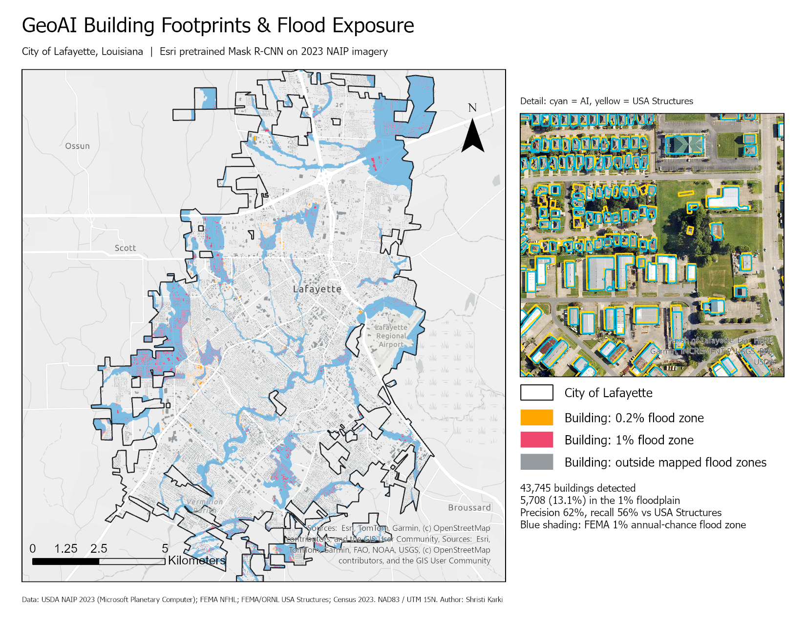
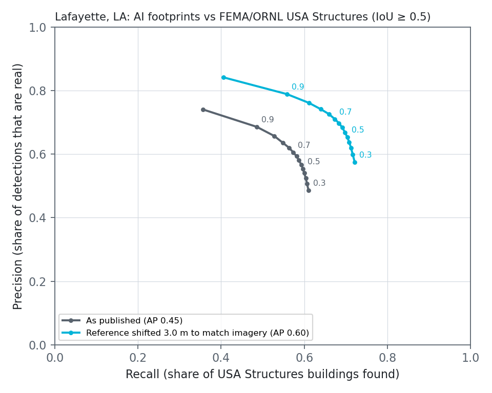
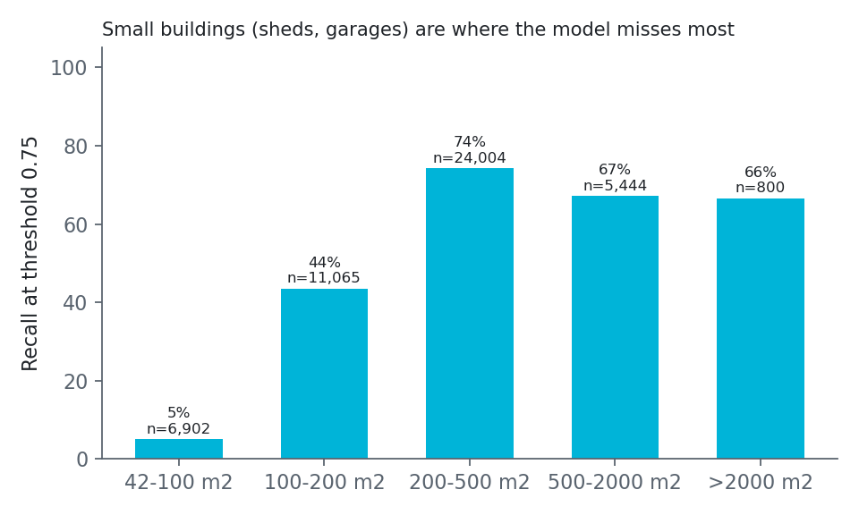
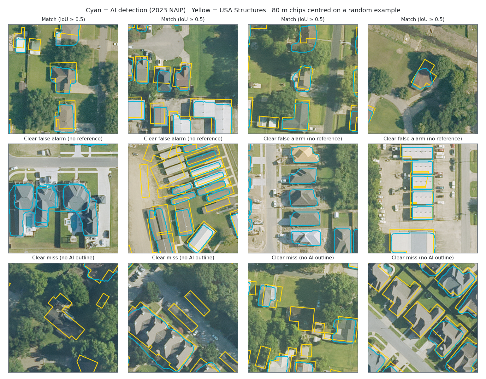
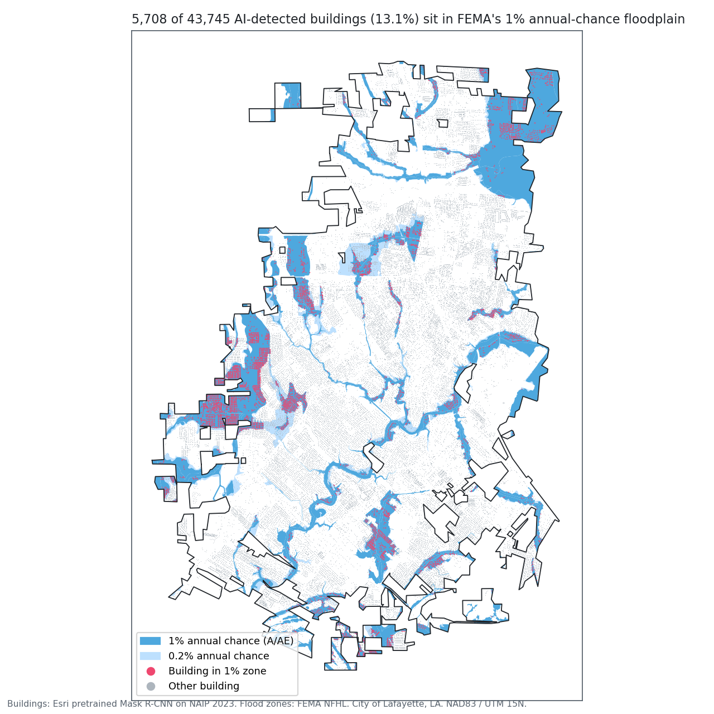

# GeoAI Building Footprints & Flood Exposure — Lafayette, Louisiana

I ran Esri's pretrained deep-learning building detector (Mask R-CNN, ArcGIS
Image Analyst) on **145 km² of 2023 aerial imagery covering the City of
Lafayette**, using a laptop GPU. I then checked the results against FEMA's
national building inventory and counted how many buildings sit in FEMA flood
zones.

The project's main finding is about evaluation: **the standard accuracy score
undersells this model.** About two-thirds of the apparent errors (25,648 of
37,654) are buildings that *both* datasets contain but place or outline
differently. Part of that is a 3 m registration offset between the reference
and the 2023 imagery, which has nothing to do with the model.

**[Open the interactive web map (ArcGIS Online)](https://www.arcgis.com/apps/mapviewer/index.html?webmap=5c73967cd06548b39bc8ebc29a5ffed0)**: every detected building, coloured by flood zone, over imagery.



## Results

**43,745 buildings detected. 5,708 of them (13.1%) are in FEMA's 1% annual-chance
(100-year) floodplain.** FEMA/ORNL USA Structures, built from separate
imagery, gives almost the same share: 6,308 of 48,215 (13.1%).

| Accuracy vs USA Structures (48,215 buildings ≥ 450 sq ft) | As published | Reference shifted 3 m to match the imagery |
|---|---|---|
| Average precision (IoU ≥ 0.5) | 0.45 | **0.60** |
| Best F1 (confidence cut-off) | 0.59 (0.75) | **0.69** (0.70) |
| Precision at best F1 | 62% | 71% |
| Recall at best F1 | 56% | 67% |
| Median IoU of matched buildings | 0.63 | 0.71 |



### What the error actually is

- **The two datasets don't line up.** Matched buildings in USA Structures sit
  a median **3.0 m** (1.0 m east, 2.0 m north) from the same roofs in NAIP 2023.
  That is 10 NAIP pixels. Even a *perfect* outline of a 12 m × 12 m house
  scores an IoU of only about 0.6 against a copy shifted that far, so any
  ordinary outline difference on top drops it below the 0.5 pass mark.
  Shifting the reference back by the median offset raises average precision
  from 0.45 to 0.60 without changing a single AI polygon.
- **Most "false alarms" are real buildings.** At the best cut-off, 16,592 AI
  polygons fail to match. Only **2,108 (13%)** overlap no reference building at
  all. The rest are buildings both datasets contain but outline differently.
  The clear false alarms include new subdivisions built after the reference's
  2022 imagery, so some are not errors at all.
- **Misses are mostly small or hidden buildings.** Of 21,062 reference
  buildings without a match, 9,898 have no AI outline anywhere near them.
  Recall falls to **5%** for buildings of 42–100 m² (sheds, detached garages),
  compared with **74%** for 200–500 m², the size of a typical house. Houses
  under tree canopy and rows of adjacent houses merged into one outline make
  up most of the rest.





### Flood exposure



| FEMA zone | AI (NAIP 2023) | USA Structures |
|---|---|---|
| A / AE / AH (1% annual chance) | 5,708 (13.0%) | 6,308 (13.1%) |
| X shaded (0.2% annual chance) | 1,785 (4.1%) | 1,958 (4.1%) |
| Minimal hazard / unmapped | 36,252 (82.9%) | 39,949 (82.9%) |

The AI undercounts buildings by about 9%, mostly sheds and garages. It
undercounts them evenly, though, so **the floodplain share matches the
national inventory to within 0.1 percentage points.** For a "what share of
the city is exposed" question, a pretrained model on free imagery gives the
same answer as the federal dataset. For a "how many structures" question, it
would need the small-building gap fixed first.

## Method

| Step | Script | Notes |
|---|---|---|
| 1. Imagery | `download_naip.py` | NAIP 2023, 0.3 m, from Microsoft Planetary Computer. Streams only the part of each of 11 tiles that overlaps the city (Cloud-Optimized GeoTIFF windows), RGB only. |
| 2. Reference data | `get_reference.py` | USA Structures (Esri Living Atlas) and FEMA NFHL flood zones via paged REST queries. |
| 3. Detection | `detect_buildings.py` | *Detect Objects Using Deep Learning* with Esri's **Building Footprint Extraction – USA** model, on the GPU (RTX 4050 laptop, **76 min for the whole city**). Low 0.3 cut-off with confidence kept, then *Non Maximum Suppression* across tile seams: 120,350 raw → 92,790 → 69,605 in city. Resumes per tile. |
| 4. Evaluation | `evaluate.py` + `geoai_metrics.py` | COCO-style one-to-one matching at IoU ≥ 0.5, precision–recall sweep, average precision, recall by size and occupancy, median registration offset and an offset-corrected re-score. Both datasets are filtered to the same ≥ 450 sq ft minimum and the same "centre inside the city" rule. |
| 5. Outputs | `make_figures.py`, `make_aprx.py`, `publish_agol.py` | README figures, an ArcGIS Pro project with a print layout, and the public web map. |

`run_city.sh` chains steps 1, 3 and 4 so they run unattended (it keeps the
laptop awake and resumes after interruptions).

### Lessons from making it work

- **Set GPU use with `arcpy.EnvManager(processorType="GPU")`.** A plain
  `arcpy.env.processorType` assignment was silently ignored, and the tool ran
  about 50× slower on the CPU. I caught it from `nvidia-smi` memory use.
- **Confidence is stored as a percentage (30–100), not 0–1.** My first
  threshold sweep was flat because every cut-off was below the minimum score.
- **Windows Smart App Control blocks** an OpenCV DLL that the ArcGIS deep
  learning installer adds, which breaks every Image Analyst deep-learning tool
  with a misleading "install the dependencies" error. The Code Integrity event
  log names the blocked file.

## Limitations

- USA Structures is itself derived by machine learning (ORNL), so it is a
  reference, not ground truth. A hand-digitized sample would give the true
  precision. That is the next step.
- The model was used as Esri ships it. Fine-tuning on a few hundred Lafayette
  chips (especially small buildings and tree-covered roofs) is the obvious
  improvement.
- The flood count uses each building's centroid against FEMA's regulatory
  zones. It is not a depth or damage estimate.

## Reproduce

Requires ArcGIS Pro 3.x with Image Analyst, the *Deep Learning Libraries
Installer for ArcGIS Pro*, and an NVIDIA GPU (CPU works, much slower).

```bash
propy scripts/download_naip.py      # ~7 GB of imagery windows (DEFLATE)
propy scripts/get_reference.py
propy scripts/detect_buildings.py   # ~75 min on an RTX 4050
propy scripts/evaluate.py
propy scripts/make_figures.py && propy scripts/make_aprx.py
python -m pytest tests              # matching / PR / AP unit tests, no ArcGIS needed
```

The model package (`usa_building_footprints.dlpk`) comes from ArcGIS Living
Atlas, item `a6857359a1cd44839781a4f113cd5934`. Place it in `data/raw/`.

## Data

- USDA NAIP 2023, Louisiana, via Microsoft Planetary Computer
- Esri, *Building Footprint Extraction – USA* (pretrained Mask R-CNN), ArcGIS Living Atlas
- FEMA / Oak Ridge National Laboratory, *USA Structures*
- FEMA National Flood Hazard Layer
- U.S. Census Bureau, 2023 cartographic boundary files (City of Lafayette)
